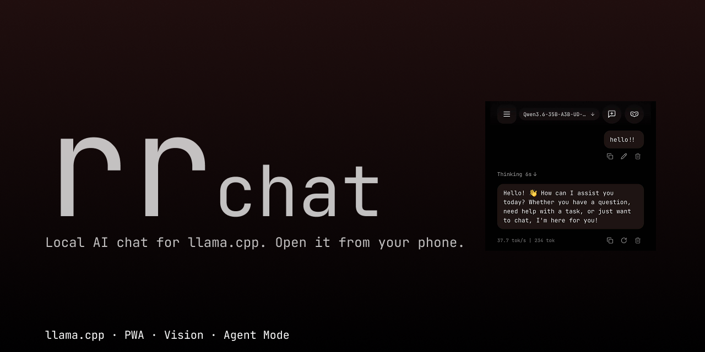
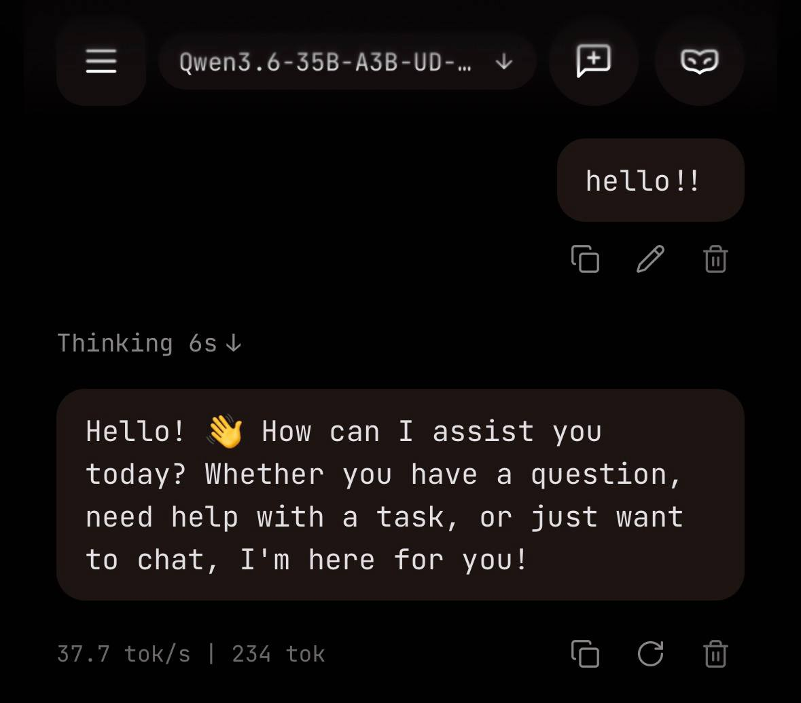
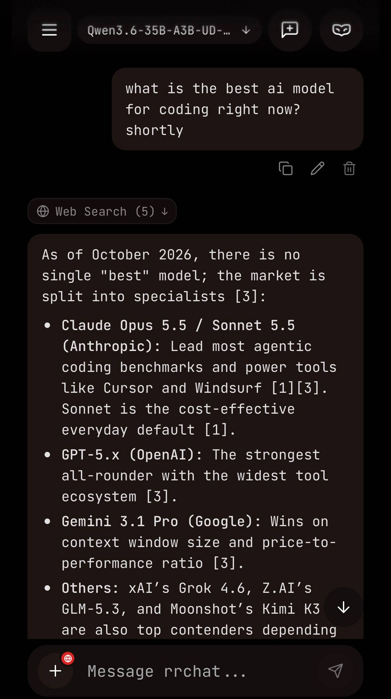
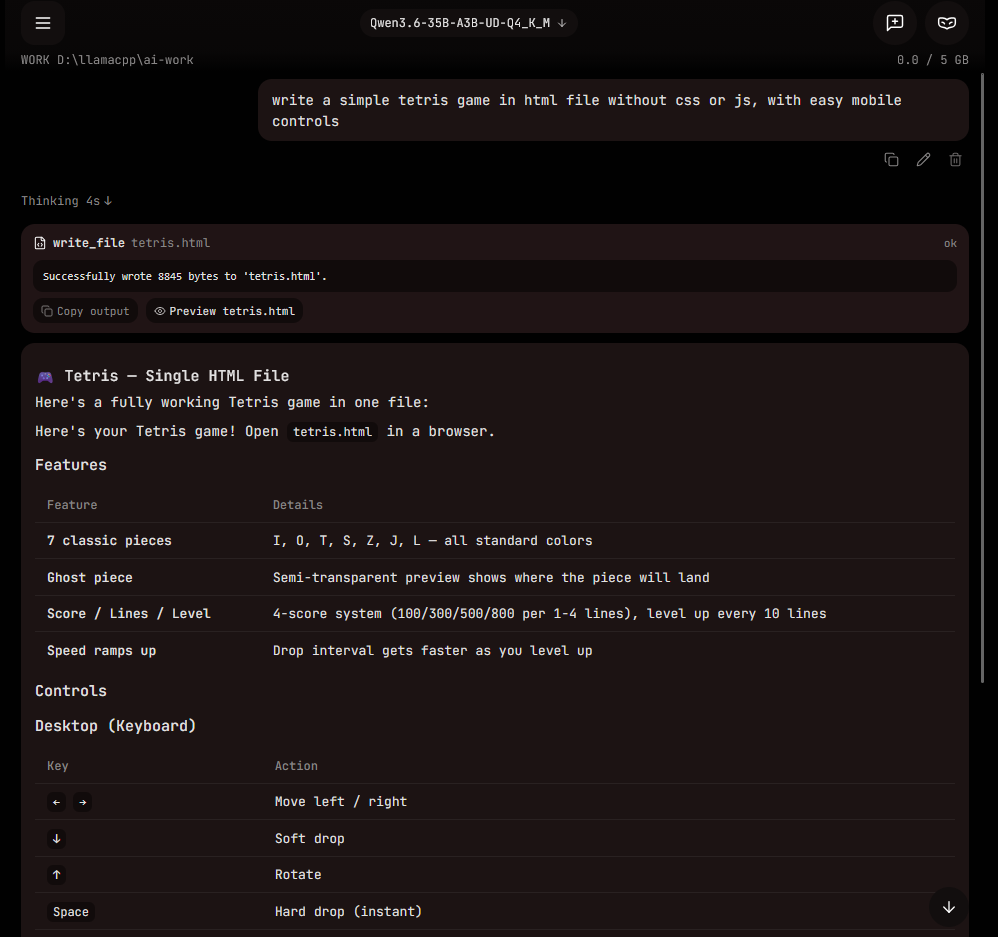

<p align="center">
  
</p>

# rrchat

A local chat for llama.cpp models on Windows. rrchat starts and manages `llama-server` for you and serves a web UI that works in the browser on your PC and as an installable app (PWA) on your phone.

YOU CAN USE RRCHAT MODELS FROM HF (https://huggingface.co/rrchat) FOR BEST EXPERIENCE

Everything runs on your own machine. Models are regular `.gguf` files: Llama, Qwen, Mistral, Gemma, Phi, DeepSeek, or anything else llama.cpp can load.

<p align="center">
  
</p>

## What it does

- Launches, monitors and unloads `llama-server.exe` processes. While you chat it shows VRAM, RAM and context usage, and remembers GPU layers and context size per model.
- Shows the model's reasoning (`<think>`) in a collapsible block with a timer and markdown rendering.
- Accepts images and documents (PDF, TXT, MD, code, CSV, JSON). If the main model can't see images, they are sent to a separate OCR model such as GLM-OCR.
- **Smart Web Search**: Lets the model search the web on its own: it decides when to search, writes the query and uses the results in its answer.

<p align="center">
  
</p>

- **Work Mode (Agent)**: A file agent locked to one folder that can read, create, edit and move files, and asks for confirmation before anything destructive.

<p align="center">
  
</p>

- Works from a phone: scan a QR code, add it to the home screen, and it runs full-screen with safe-area support on iOS and Android.
- Can be reached from outside your home network through Tailscale Funnel.
- Comes with a setup wizard for the first launch.

## Requirements

- Windows 10/11 x64
- Node.js 18 or newer
- `llama-server.exe` built for CUDA, Vulkan or CPU. Get it from the [llama.cpp releases](https://github.com/ggml-org/llama.cpp/releases), or let the setup wizard download it.
- Some `.gguf` models

## Install

```cmd
git clone https://github.com/leftik1/rrchat.git
cd rrchat
setup.bat
```

`setup.bat` installs the dependencies for the client and the server and builds the project.

To start the chat, run `run-chat.bat` (or `npm start` in the project folder).

On the first launch rrchat opens `http://localhost:3000/setup`. The wizard will:

- detect your GPU and find or download `llama-server.exe`,
- ask for your models folder and the workspace folder for Work Mode,
- let you pick the network mode (home Wi-Fi or Tailscale Funnel),
- generate an access token and show a QR code.

## Using it from your phone

### On home Wi-Fi

1. Connect the phone to the same network as the PC.
2. Scan the QR code from the terminal or from the admin panel at `http://localhost:3000/admin`.
3. The token gives you a 30-day session and disappears from the address bar after the first open.
4. On iOS Safari or Android Chrome, use "Add to Home Screen" to install it as an app.

### From anywhere (Tailscale Funnel)

1. Install [Tailscale](https://tailscale.com/) on the PC.
2. Run:
   ```cmd
   tailscale funnel 3000
   ```
3. Tailscale gives you an HTTPS address like `https://<your-node>.ts.net/`. Open it on the phone.

The phone doesn't need Tailscale installed, so it can stay on mobile data or behind your own VPN.

## Security

Funnel puts the server on the public internet. Anyone who knows your node address can try to connect, so a few things are locked down by default (details in [SECURITY.md](SECURITY.md)):

- Work Mode is off over the tunnel. File and agent requests return 403. If you turn it on with `allowWorkOverTunnel: true`, every destructive action needs a one-time confirmation.
- The admin panel (settings, paths, model configs) only opens from the PC itself.
- Five wrong token attempts lock the login for 15 minutes.
- `npm run token:reset` kills all active sessions and creates a new token.

Under the hood: 256-bit random tokens, constant-time SHA-256 comparison, sessions stored in SQLite, `HttpOnly` and `SameSite=Strict` cookies, and protection against CSRF and DNS rebinding.

## Configuration

The wizard creates `config.json`. You can also edit it by hand.

| Option | Default | What it does |
| :--- | :--- | :--- |
| `llamaServerPath` | `""` | Full path to `llama-server.exe` |
| `modelsDir` | `""` | Folder with `.gguf` models (scanned recursively) |
| `workDir` | `""` | Folder the file agent is allowed to work in |
| `workQuotaGB` | `5` | Disk quota for that folder, in GB |
| `workModeEnabled` | `false` | Turns Work Mode on or off |
| `listenHost` | `"0.0.0.0"` | Address the server binds to |
| `port` | `3000` | Web server port |
| `maxAgentSteps` | `15` | Max steps the agent can take per request |
| `commandTimeoutSec` | `60` | Timeout for agent commands, in seconds |
| `autoApproveCommands` | `true` | Auto-approve non-destructive file operations |
| `agentWebSearch` | `true` | Lets the model search the web |
| `language` | `"en"` | Interface language, `"en"` or `"ru"` |
| `modelSettings` | `{}` | Per-model context size, GPU layers and VRAM calibration |

## Development

| Command | What it does |
| :--- | :--- |
| `npm run dev` | Backend in watch mode (`tsx watch`) |
| `npm run build` | Builds the client (Vite + TypeScript) and the server (TypeScript) |
| `npm test` | Server tests (Vitest, 84 tests in 15 suites) |
| `npm run security-check` | Black-box checks for DNS rebinding, CSRF, Funnel lockdown and CSP |
| `npm run token:reset` | Revokes all sessions and generates a new token |


> AI can make mistakes. Always check important information yourself.

## License

MIT. Copyright (c) 2026 [leftik1](https://github.com/leftik1).
